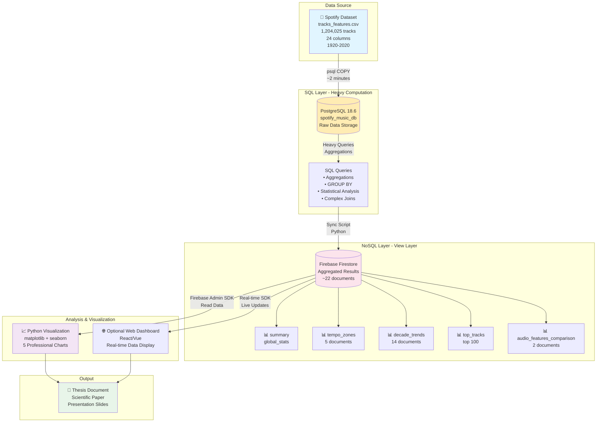

# System Architecture

## **Spotify Tempo Sweet Spot Analysis**
### Big Data Thesis Project - Hybrid SQL + NoSQL Architecture

---

## **Architecture Overview**



---

## **System Components**

### **1. Data Source Layer**
- **Dataset:** Spotify Tracks Features
- **Size:** 1,204,025 records
- **Columns:** 24 audio features + metadata
- **Time Range:** 1920-2020 (100 years)
- **Format:** CSV (UTF-8 encoded)

**Key Features:**
- `tempo` (BPM)
- `energy` (0-1)
- `danceability` (0-1)
- `valence` (0-1)
- `acousticness` (0-1)
- `year`, `name`, `artists`, etc.

---

### **2. SQL Layer - PostgreSQL**

**Purpose:** Heavy computation & raw data storage

**Technology:**
- PostgreSQL 18.6
- Single table: `spotify_tracks_raw`
- Location: `localhost:5432`

**Operations:**
```sql
-- Complex aggregations
SELECT tempo_zone, COUNT(*), AVG(energy), AVG(danceability)
FROM spotify_tracks_raw
WHERE tempo BETWEEN 100 AND 120
GROUP BY tempo_zone;

-- Statistical analysis
SELECT 
    FLOOR(year/10)*10 as decade,
    COUNT(CASE WHEN tempo BETWEEN 100 AND 120 THEN 1 END) as sweet_spot_count
FROM spotify_tracks_raw
GROUP BY decade;
```

**Why PostgreSQL?**
- ✅ Excellent for analytical queries
- ✅ Mature aggregation functions
- ✅ Support for complex JOINs
- ✅ ACID compliance
- ✅ Open source & free

---

### **3. NoSQL Layer - Firebase Firestore**

**Purpose:** Lightweight view layer for fast read access

**Technology:**
- Firebase Firestore (Cloud NoSQL)
- Document-based database
- Real-time synchronization

**Collections Structure:**
```
firestore/
├── summary/
│   └── global_stats {
│       total_tracks: 1204025,
│       avg_tempo: 117.63,
│       sweet_spot_percentage: 22.18
│   }
├── tempo_zones/ (5 docs)
│   ├── 100_120 (Sweet Spot)
│   ├── 120_140
│   ├── 80_100
│   ├── less_80
│   └── above_140
├── decade_trends/ (14 docs)
│   ├── 1900, 1910, ..., 2020
├── top_tracks/ (1 doc)
│   └── sweet_spot_top_100 (array of 100 tracks)
└── audio_features_comparison/ (2 docs)
    ├── sweet_spot
    └── other_tempo
```

**Total Documents:** ~22 (NOT 1.2M!)

**Why Firestore?**
- ✅ Fast read access (no computation needed)
- ✅ Real-time sync capabilities
- ✅ Scalable for web/mobile apps
- ✅ Free tier sufficient for this project
- ✅ Cloud-native (no server management)

---

### **4. Sync Pipeline**

**Script:** `sync_postgres_to_firestore.py`

**Process:**
1. Connect to PostgreSQL
2. Execute aggregation queries
3. Parse results into JSON
4. Upload to Firestore collections
5. Timestamp each sync

**Frequency:**
- Manual trigger (on-demand)
- Typical: Once after data load
- Optional: Scheduled updates (e.g., weekly)

**Performance:**
- Sync time: ~10-15 seconds
- Data transferred: ~50KB (aggregated only)

---

### **5. Analysis & Visualization Layer**

**Script:** `visualize_analysis.py`

**Libraries:**
- `matplotlib` - Static charts
- `seaborn` - Statistical plots
- `pandas` - Data manipulation
- `firebase-admin` - Firestore access

**Output Charts:**
1. Tempo Distribution (Bar)
2. Danceability Comparison (Bar)
3. Decade Trends (Line)
4. Audio Features Radar (Polar)
5. Summary Stats (Infographic)

**Format:** PNG (300 DPI, publication-ready)

---

## **Data Flow**

### **Loading Phase:**
```
CSV File (1.2M rows)
    ↓ [psql COPY command]
PostgreSQL (Raw Storage)
    ↓ [~2 minutes]
✅ Ready for analysis
```

### **Analysis Phase:**
```
PostgreSQL
    ↓ [SQL Aggregations]
Computed Results
    ↓ [Python Script]
Firestore (View Layer)
    ↓ [Firebase SDK]
Python Visualization / Web Dashboard
```

---

## **Key Design Decisions**

### **1. Why Hybrid Architecture (SQL + NoSQL)?**

**PostgreSQL for:**
- ✅ Complex aggregations (`GROUP BY`, `OVER`, `CASE WHEN`)
- ✅ Statistical computations
- ✅ Full dataset queries
- ✅ Data integrity (ACID)

**Firestore for:**
- ✅ Fast read access (pre-computed results)
- ✅ Real-time sync (for web demos)
- ✅ Scalability (handles 1M+ reads easily)
- ✅ No server management

### **2. Why NOT Sync All 1.2M Records to Firestore?**

**Cost:**
- Firestore charges per read/write
- 1.2M writes = expensive
- Query 1.2M docs = slow

**Solution:**
- Store only aggregated results (~22 docs)
- PostgreSQL remains source of truth
- Firestore as "materialized view"

### **3. Why NOT Use MongoDB Instead?**

**Firebase/Firestore Advantages:**
- ⚡ Setup time: 5 minutes vs 1 hour
- 🔥 Real-time sync built-in
- ☁️ Hosting included (Firebase Hosting)
- 💰 Free tier sufficient
- 🚀 Faster for this use case

---

## **Performance Metrics**

| Operation | Time | Notes |
|-----------|------|-------|
| CSV → PostgreSQL | ~2 min | 1.2M records via COPY |
| PostgreSQL Query | <5 sec | Aggregations with indexes |
| PostgreSQL → Firestore Sync | ~15 sec | 22 documents |
| Firestore Read (all) | <1 sec | Pre-aggregated data |
| Visualization Generation | ~10 sec | 5 charts, 300 DPI |

---

## **Security & Best Practices**

### **Credentials Management:**
```gitignore
# NEVER commit these!
firebase-credentials.json
*.env
```

### **Database Access:**
- PostgreSQL: localhost only (development)
- Firestore: Service account with minimal permissions
- Test mode rules expire in 30 days

### **Production Recommendations:**
- Use environment variables for passwords
- Enable Firestore security rules
- Add PostgreSQL SSL for remote access
- Implement backup strategy

---

## **Scalability Considerations**

### **Current Scale:**
- 1.2M records: ✅ No issues
- PostgreSQL can handle 100M+ rows
- Firestore: 22 docs (negligible)

### **Future Scale (10M+ tracks):**
- PostgreSQL: Add indexes, partitioning
- Firestore: Same structure (still ~22 docs)
- Sync time: May increase to 1-2 minutes

---

## **Technology Stack**

| Component | Technology | Version |
|-----------|-----------|---------|
| Database (SQL) | PostgreSQL | 18.6 |
| Database (NoSQL) | Firebase Firestore | Cloud |
| Backend Language | Python | 3.14 |
| Data Processing | pandas | 3.0+ |
| Visualization | matplotlib + seaborn | Latest |
| Sync Tool | firebase-admin SDK | 7.7.0 |
| Optional Frontend | React/Vue | TBD |

---

## **Advantages of This Architecture**

✅ **Separation of Concerns:**
- SQL = Heavy lifting (compute)
- NoSQL = Fast delivery (read)

✅ **Cost Effective:**
- PostgreSQL = Free (self-hosted)
- Firestore = Free tier sufficient

✅ **Research Friendly:**
- SQL for ad-hoc queries
- Pre-computed results for presentation

✅ **Industry Relevant:**
- Hybrid architecture common in production
- Shows understanding of tradeoffs

✅ **Academically Sound:**
- Proper Big Data concepts (ETL, data lake, serving layer)
- Demonstrates SQL vs NoSQL understanding

---

## **Conclusion**

This architecture demonstrates:
1. **Big Data Engineering:** ETL pipeline, data warehouse, serving layer
2. **Database Expertise:** SQL optimization, NoSQL data modeling
3. **Cloud Computing:** Firebase cloud services
4. **Research Methodology:** Proper analysis workflow

**Perfect for thesis requirement: "SQL + NoSQL database architecture"** ✅
