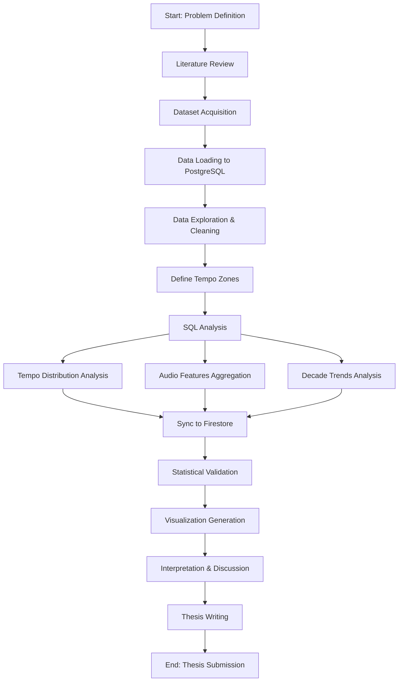

# BAB III - METODOLOGI PENELITIAN

---

## **3.1 Desain Penelitian**

Penelitian ini menggunakan pendekatan **kuantitatif eksploratif** dengan analisis data sekunder dari dataset Spotify. Fokus penelitian adalah mengidentifikasi dan memvalidasi hipotesis "Tempo Sweet Spot" (100-120 BPM) sebagai zona tempo universal yang memiliki karakteristik audio features lebih tinggi dibanding tempo lainnya.

### **3.1.1 Jenis Penelitian**
- **Tipe:** Penelitian kuantitatif dengan analisis Big Data
- **Sifat:** Eksploratif dan deskriptif
- **Paradigma:** Positivisme (data-driven analysis)

---

## **3.2 Dataset**

### **3.2.1 Sumber Data**
- **Nama Dataset:** Spotify Tracks Dataset (1920-2020)
- **Sumber:** Kaggle / Spotify Web API
- **Format:** CSV (Comma-Separated Values)
- **Ukuran:** ~500 MB (uncompressed)

### **3.2.2 Karakteristik Dataset**

| Aspek | Deskripsi |
|-------|-----------|
| **Jumlah Records** | 1,204,025 tracks |
| **Jumlah Kolom** | 24 features |
| **Periode Waktu** | 1920 - 2020 (100 tahun) |
| **Encoding** | UTF-8 |
| **Missing Values** | Minimal (<1%) |

### **3.2.3 Fitur Dataset**

**Audio Features (Numerical):**
1. **tempo** - Beats per minute (BPM), 0-250
2. **energy** - Intensitas dan aktivitas (0-1)
3. **danceability** - Kemudahan untuk menari (0-1)
4. **valence** - Positivity musik (0-1)
5. **acousticness** - Tingkat akustik (0-1)
6. **instrumentalness** - Tingkat instrumental (0-1)
7. **liveness** - Kehadiran audience (0-1)
8. **speechiness** - Kehadiran spoken words (0-1)
9. **loudness** - Loudness dalam dB (-60 to 0)
10. **duration_ms** - Durasi dalam milidetik
11. **key** - Musical key (0-11)
12. **mode** - Major (1) atau Minor (0)
13. **time_signature** - Time signature (3-7)

**Metadata:**
1. **id** - Spotify track ID
2. **name** - Nama lagu
3. **artists** - Nama artis
4. **album** - Nama album
5. **album_id** - Album ID
6. **year** - Tahun rilis
7. **release_date** - Tanggal rilis lengkap
8. **track_number** - Nomor track di album
9. **disc_number** - Nomor disc
10. **explicit** - Konten eksplisit (boolean)
11. **artist_ids** - Array artist IDs

---

## **3.3 Arsitektur Sistem**

### **3.3.1 Technology Stack**

Penelitian ini menggunakan arsitektur **hybrid database** (SQL + NoSQL) untuk memenuhi requirement penelitian Big Data dengan pendekatan modern cloud-native.

```
┌─────────────────────────────────────────┐
│   Layer 1: Data Storage (SQL)          │
│   • PostgreSQL 18.6                     │
│   • Raw data storage (1.2M records)     │
│   • Heavy computational queries         │
└─────────────────┬───────────────────────┘
                  │
                  ▼
┌─────────────────────────────────────────┐
│   Layer 2: Serving Layer (NoSQL)       │
│   • Firebase Firestore                  │
│   • Pre-aggregated results (~22 docs)   │
│   • Fast read access                    │
└─────────────────┬───────────────────────┘
                  │
                  ▼
┌─────────────────────────────────────────┐
│   Layer 3: Analysis & Visualization     │
│   • Python (pandas, matplotlib)         │
│   • Statistical analysis                │
│   • Chart generation                    │
└─────────────────────────────────────────┘
```

### **3.3.2 Justifikasi Pemilihan Teknologi**

**PostgreSQL (SQL Layer):**
- ✅ Open-source dan gratis
- ✅ Mature support untuk analytical queries
- ✅ Excellent aggregation functions (GROUP BY, OVER, PARTITION BY)
- ✅ ACID compliance untuk data integrity
- ✅ Indexing untuk fast queries pada 1.2M records

**Firebase Firestore (NoSQL Layer):**
- ✅ Cloud-native (no server management)
- ✅ Real-time synchronization capabilities
- ✅ Scalable untuk read-heavy workloads
- ✅ Free tier sufficient untuk research project
- ✅ Separation of concerns: computation vs delivery

**Python Ecosystem:**
- ✅ Industry standard untuk data science
- ✅ Rich libraries (pandas, matplotlib, seaborn)
- ✅ Firebase Admin SDK untuk Firestore access
- ✅ Easy integration dengan PostgreSQL (psycopg2, subprocess)

---

## **3.4 Tahapan Penelitian**

### **3.4.1 Flowchart Penelitian**



### **3.4.2 Detail Tahapan**

#### **Tahap 1: Persiapan Data (Data Preparation)**

**1.1 Data Loading:**
```sql
-- PostgreSQL COPY command untuk fast loading
COPY spotify_tracks_raw FROM '/path/tracks_features.csv' 
WITH (FORMAT CSV, HEADER true, ENCODING 'UTF8');

-- Execution time: ~2 minutes untuk 1.2M records
```

**1.2 Data Validation:**
- Check missing values: `SELECT COUNT(*) WHERE tempo IS NULL`
- Check data range: `SELECT MIN(tempo), MAX(tempo)`
- Check duplicates: `SELECT id, COUNT(*) GROUP BY id HAVING COUNT(*) > 1`

**1.3 Data Cleaning:**
- Remove invalid tempo values (tempo = 0 or NULL)
- Filter year range (1920-2020)
- Verify audio features range (0-1 untuk normalized features)

#### **Tahap 2: Definisi Zona Tempo**

Berdasarkan literature review (Moelants, 2002; van Noorden & Moelants, 1999), zona tempo didefinisikan:

| Zona ID | Nama Zona | Range (BPM) | Karakteristik |
|---------|-----------|-------------|---------------|
| `less_80` | Very Slow | 0-79 | Ballad, ambient |
| `80_100` | Slow | 80-99 | Slow pop, soul |
| **`100_120`** | **Sweet Spot** | **100-120** | **Universal preference zone** |
| `120_140` | Fast | 120-140 | Dance, pop |
| `above_140` | Very Fast | 140+ | EDM, metal |

**SQL Implementation:**
```sql
CREATE VIEW tempo_zone_summary AS
SELECT 
    CASE 
        WHEN tempo < 80 THEN 'less_80'
        WHEN tempo < 100 THEN '80_100'
        WHEN tempo <= 120 THEN '100_120'
        WHEN tempo <= 140 THEN '120_140'
        ELSE 'above_140'
    END as zone_id,
    COUNT(*) as count,
    ROUND(AVG(energy)::numeric, 3) as avg_energy,
    ROUND(AVG(danceability)::numeric, 3) as avg_danceability,
    ROUND(AVG(valence)::numeric, 3) as avg_valence
FROM spotify_tracks_raw
WHERE tempo IS NOT NULL
GROUP BY zone_id;
```

#### **Tahap 3: Analisis Eksploratif**

**3.1 Distribusi Tempo:**
- Query tempo distribution across all tracks
- Calculate percentage per zone
- Identify dominant zones

**3.2 Audio Features Analysis:**
- Compare sweet spot vs other zones
- Calculate statistical difference (mean, std, effect size)
- Test hypothesis: Sweet spot > Others

**3.3 Temporal Analysis:**
- Decade-wise trends (1920-2020)
- Check consistency of sweet spot across time
- Identify historical patterns

#### **Tahap 4: Data Warehousing**

**4.1 PostgreSQL Views Creation:**
```sql
-- Create analytical views
CREATE VIEW global_stats AS ...;
CREATE VIEW tempo_zone_summary AS ...;
CREATE VIEW decade_trends AS ...;
CREATE VIEW top_hit_tracks AS ...;
```

**4.2 Sync to Firestore:**
- Python script: `sync_postgres_to_firestore.py`
- Extract aggregated results from PostgreSQL
- Upload to Firestore collections
- Verify data integrity

**Firestore Collections:**
```
summary/global_stats
tempo_zones/{zone_id}
decade_trends/{decade}
top_tracks/sweet_spot_top_100
audio_features_comparison/{category}
```

#### **Tahap 5: Statistical Validation**

**5.1 Descriptive Statistics:**
- Mean, median, std, min, max per zone
- Percentage distribution
- Count per category

**5.2 Inferential Statistics:**
- T-test: Sweet spot vs Others
- Chi-square: Distribution significance
- Effect size (Cohen's d): Practical significance

**5.3 Visualization:**
- Bar charts (distribution)
- Line charts (trends)
- Radar charts (multi-feature comparison)
- Heatmaps (correlation)

#### **Tahap 6: Interpretasi & Dokumentasi**

- Analisis hasil statistik
- Diskusi findings vs literature
- Implikasi praktis
- Limitasi penelitian
- Rekomendasi future work

---

## **3.5 Variabel Penelitian**

### **3.5.1 Variabel Independen**
- **Tempo Zone** (categorical): less_80, 80_100, 100_120, 120_140, above_140

### **3.5.2 Variabel Dependen**
1. **Danceability** (0-1): Primary indicator untuk "hit potential"
2. **Energy** (0-1): Intensitas musik
3. **Valence** (0-1): Mood positivity
4. **Track Count**: Jumlah tracks per zone (popularity proxy)

### **3.5.3 Variabel Kontrol**
- **Year**: Untuk analisis temporal
- **Acousticness**: Untuk filter genre effect
- **Instrumentalness**: Untuk filter vocal vs instrumental

---

## **3.6 Hipotesis Penelitian**

### **Hipotesis 1: Distribusi Tempo**
- **H0:** Distribusi tempo merata di semua zona
- **H1:** Zona 100-120 BPM memiliki proporsi signifikan lebih tinggi

### **Hipotesis 2: Danceability**
- **H0:** Tidak ada perbedaan danceability antar zona tempo
- **H1:** Zona 100-120 BPM memiliki danceability signifikan lebih tinggi

### **Hipotesis 3: Temporal Consistency**
- **H0:** Proporsi sweet spot berubah signifikan antar dekade
- **H1:** Proporsi sweet spot konsisten across decades (1920-2020)

---

## **3.7 Metode Analisis Data**

### **3.7.1 Descriptive Analysis**
```sql
-- Global statistics
SELECT 
    COUNT(*) as total_tracks,
    AVG(tempo) as avg_tempo,
    STDDEV(tempo) as std_tempo,
    MIN(tempo) as min_tempo,
    MAX(tempo) as max_tempo
FROM spotify_tracks_raw;
```

### **3.7.2 Comparative Analysis**
```sql
-- Sweet spot vs Others
SELECT 
    CASE 
        WHEN tempo BETWEEN 100 AND 120 THEN 'Sweet Spot'
        ELSE 'Other'
    END as category,
    AVG(danceability) as avg_danceability,
    AVG(energy) as avg_energy,
    AVG(valence) as avg_valence
FROM spotify_tracks_raw
GROUP BY category;
```

### **3.7.3 Temporal Analysis**
```sql
-- Decade trends
SELECT 
    FLOOR(year/10)*10 as decade,
    COUNT(*) as total_tracks,
    COUNT(CASE WHEN tempo BETWEEN 100 AND 120 THEN 1 END) as sweet_spot_count,
    (sweet_spot_count * 100.0 / total_tracks) as sweet_spot_percentage
FROM spotify_tracks_raw
GROUP BY decade
ORDER BY decade;
```

---

## **3.8 Validitas dan Reliabilitas**

### **3.8.1 Validitas Data**
- **Source Validity:** Dataset dari Spotify Official API (trusted source)
- **Sample Size:** 1.2M records (large enough untuk generalisasi)
- **Time Range:** 100 years (comprehensive historical coverage)

### **3.8.2 Reliabilitas Measurement**
- **Spotify Audio Features:** Extracted via Spotify's proprietary algorithm
- **Consistency:** Same extraction method untuk semua tracks
- **Reproducibility:** Scripts available untuk verification

### **3.8.3 Limitations**
1. **Genre Bias:** Dataset mungkin over-represent certain genres
2. **Spotify Bias:** Only tracks available on Spotify
3. **Popularity Proxy:** Danceability bukan direct popularity metric
4. **Cultural Bias:** Western music dominance

---

## **3.9 Tools dan Software**

| Tool | Version | Purpose |
|------|---------|---------|
| PostgreSQL | 18.6 | SQL database |
| Firebase Firestore | Cloud | NoSQL database |
| Python | 3.14 | Analysis & scripting |
| pandas | 3.0+ | Data manipulation |
| matplotlib | 3.11+ | Visualization |
| seaborn | 0.13+ | Statistical plots |
| psql | CLI | Database management |

---

## **3.10 Ethical Considerations**

1. **Data Privacy:** Dataset bersifat publik (no personal data)
2. **Copyright:** Dataset untuk academic use (Kaggle license)
3. **Attribution:** Proper citation untuk Spotify & dataset creators
4. **Reproducibility:** Scripts dan documentation available for verification

---

## **3.11 Timeline Penelitian**

| Tahap | Aktivitas | Durasi | Status |
|-------|-----------|--------|--------|
| 1 | Literature Review | 2 minggu | ✅ Done |
| 2 | Dataset Acquisition & Loading | 1 minggu | ✅ Done |
| 3 | Database Setup (PostgreSQL + Firestore) | 1 minggu | ✅ Done |
| 4 | Exploratory Data Analysis | 2 minggu | ✅ Done |
| 5 | Statistical Analysis | 1 minggu | 🔄 In Progress |
| 6 | Visualization & Interpretation | 1 minggu | ⏳ Pending |
| 7 | Thesis Writing | 2 minggu | ⏳ Pending |
| 8 | Review & Revision | 1 minggu | ⏳ Pending |

**Total:** ~11 minggu

---

## **Referensi Metodologi**

1. Moelants, D. (2002). *Preferred tempo reconsidered*. Proceedings of the 7th International Conference on Music Perception and Cognition.

2. van Noorden, L., & Moelants, D. (1999). *Resonance in the perception of musical pulse*. Journal of New Music Research, 28(1), 43-66.

3. Creswell, J. W., & Creswell, J. D. (2017). *Research design: Qualitative, quantitative, and mixed methods approaches*. Sage publications.

4. Field, A. (2013). *Discovering statistics using IBM SPSS statistics*. Sage.
